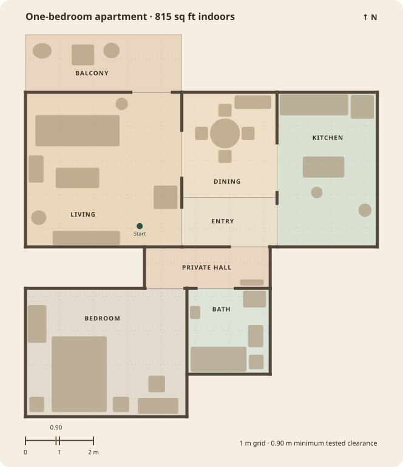

# Apartment floor plan

North is at the top. Game coordinates measure metres, with **x** east, **z** south, and **y** up. The drawing uses a 1 m grid. Its ruler marks the 0.90 m clearance, a 1 m interval, and 2 m.

| Zone | Footprint | Connections |
| --- | --- | --- |
| Living room | 6.40 × 6.40 m | Dining, landing, hall, patio |
| Dining room | 4.00 × 3.80 m | Living, kitchen, landing |
| Kitchen | 5.20 × 6.40 m | Dining, landing |
| Landing | 4.00 × 2.60 m | Living, dining, kitchen, hall |
| Hallway | 15.60 × 2.40 m | Living, landing, bedroom, bath |
| Bedroom | 8.00 × 4.80 m | Hall |
| Bathroom | 7.60 × 4.80 m | Hall |
| Patio | 6.40 × 2.70 m | Living |

The two dining approaches cross open boundaries on the living and kitchen sides. The gate tests each with a 0.45 m radius. The bedroom, bathroom, and patio openings are 1.25 m, 1.30 m, and 1.53 m before trim. Player eye level is 1.63 m and collision radius is 0.24 m. The dining tabletop and desk are 0.75 m above the floor, and walls rise 2.80 m.

The [layout table](../app/game/layout.js) holds the room bounds, furnishings, walls, resting heights, cat poses, and closed Roomba route. Regenerate the drawing with `node scripts/floor-plan.mjs` after a layout change.
